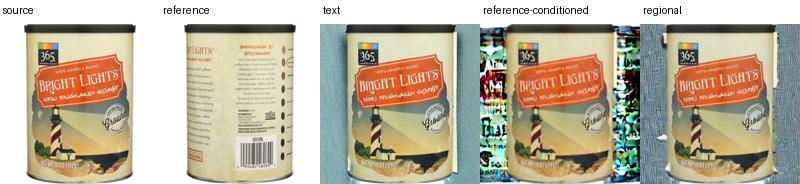

# Subject-consistent image editing



On four held-out edit requests (two products × red/blue backgrounds), global reference conditioning raised mean reference-encoder cosine from 0.562 to 0.589. Its requested-color coverage fell from 22.7% to 12.4%, and its independent foreground-color gallery retrieval succeeded on 3/4 requests. Restricting the reference attention to the foreground restored coverage to 20.4% and retrieved the correct product on 4/4 requests. The red-coffee request is a measured failure: only 0.18% of editable pixels satisfied the regional arm's red criterion. [Per-case scores](results/formal/scores.csv) · [Failure panel](results/formal/lowest-scene-score.jpg).

| Held-out mean | Text | Global reference | Regional reference |
| --- | ---: | ---: | ---: |
| Reference-feature cosine | 0.562 | 0.589 | 0.558 |
| Foreground RGB error, 0–255 | 15.43 | 17.21 | 17.06 |
| Requested background hue | 22.7% | 12.4% | 20.4% |
| Four-product gallery retrieval | 4/4 | 3/4 | 4/4 |

Use multiple views of real Amazon Berkeley Objects products to compare text-only, IP-Adapter reference conditioning, and spatially masked reference conditioning. Install CUDA PyTorch 2.4.1 and requirements.txt in a Python 3.11 environment. Run `python run.py demo` for a single object, `python run.py reproduce` for both colors on four subjects, and `python run.py evaluate` to rebuild scores.

```powershell
python -m venv .venv
.\.venv\Scripts\Activate.ps1
python -m pip install torch==2.4.1 --index-url https://download.pytorch.org/whl/cu121
python -m pip install -r requirements.txt
python -m unittest discover -s tests -v
python run.py demo --output work/demo
python run.py reproduce --output work/formal
python run.py evaluate --output work/formal
```

`src/data.py` reads the pinned publicly available photographs and extracts a white-background foreground. `src/experiment.py` uses a pretrained SD1.5 inpainting pipeline and the official SD1.5 IP-Adapter. The text control sets its scale to zero. The other two modes keep the same reference strength, target, seed and steps. The regional treatment restricts reference attention to the foreground. Two products are held out for evaluation. Reported dimensions are edit-mask-exterior RGB error, CLIP vision reference cosine and requested background hue coverage. The cosine uses the conditioning encoder and must be interpreted with the independent pixel and hue checks; it is not independent human identity recognition. A catalog image of two bottles is excluded because the mask extractor assumes one product.

The author-supplied IP-Adapter uses the same stock SD1.5 base in all arms. The Diffusers inpainting pipeline blends known-region latents on each denoising step (the four-channel U-Net pathway). Each formal held-out subject is scored against all four reference views using a foreground RGB histogram independent of CLIP. The gallery accuracy and margin describe color discrimination within these four products; they cannot capture text/logo identity on their own.

All formal references show the exterior of the same catalog product as the source. The [input audit](results/input-audit/README.md) records replacing a sachet and a human-silhouette photo with alternate views from their original listings. The separate [reference-only generation](results/author/generated.png) was produced through the original Tencent package from [this photograph](results/author/reference.png) and is outside the paired metrics.

The original catalog JPEGs are included in `examples/abo` and checked against `configs/products.json`. The contact sheet in `examples/source-images.jpg` shows actual catalog inputs. For previously downloaded models, set `SUBJECT_EDIT_SD15_ROOT` to the pinned base directory and `SUBJECT_EDIT_IP_ROOT` to the pinned adapter snapshot root. The runner verifies the hashes before inference. Otherwise it downloads the components to `.cache`. See [UPSTREAM.md](UPSTREAM.md) and [HANDOFF.md](HANDOFF.md).

To run the separate reference-only generation example directly through Tencent's original package:

```shell
git clone https://github.com/tencent-ailab/IP-Adapter.git .cache/author-code
git -C .cache/author-code checkout --detach 62e4af9d0c1ac7d5f8dd386a0ccf2211346af1a2
python author_demo.py --source .cache/author-code --output work/author
```

